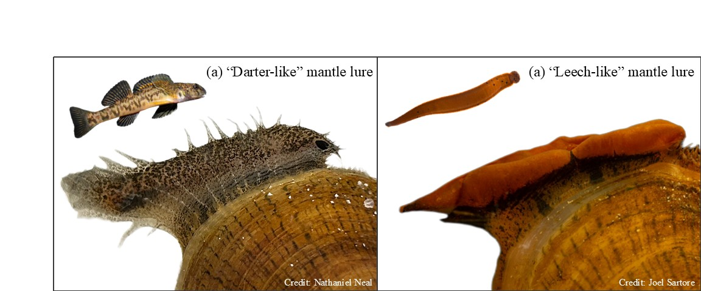

---
permalink: /research/
title: "Research"
classes: wide
---

## Evolutionary Genomics of Freshwater Mussels

My research focuses on understanding the genetic basis and evolution of complex mimicry in freshwater mussels. I am particularly interested in how genomic variation contributes to the remarkable diversity of mantle lure morphologies found throughout the tribe Lampsilini.

## The Evolution of Aggressive Mimicry

Freshwater mussels in the tribe Lampsilini exhibit elaborate mantle lures that mimic prey organisms to attract host fish. These interactions facilitate the transmission of parasitic larvae, known as glochidia.

My research investigates the genetic architecture underlying variation in these complex structures, particularly in *Lampsilis fasciola*, which exhibits distinct fish-like and leech-like lure phenotypes.

<figure>
  
  <figcaption>
    Alternative mantle lure phenotypes in Lampsilis fasciola.
  </figcaption>
</figure>

## Comparative Evolutionary Genomics

I also investigate how genomic regions associated with mantle lure variation have evolved across freshwater mussel species with different reproductive strategies.

By combining whole-genome sequencing, comparative genomics, and field observations, I aim to better understand the evolutionary processes underlying the diversification of these complex mimicry traits.
